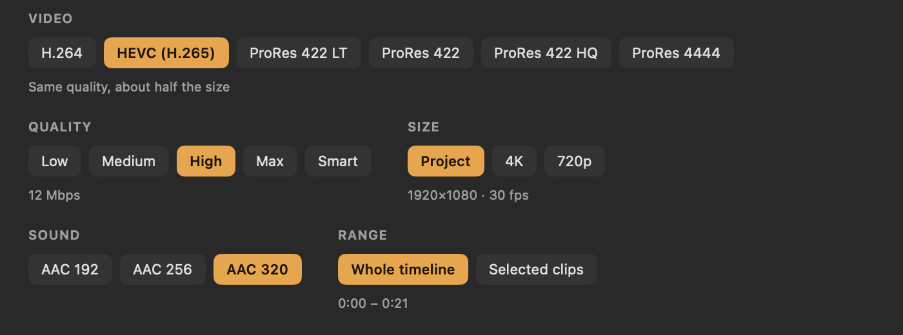

# Export just a part

1. Select the clips you want on the timeline (drag a box around them, or ⇧-click).
2. Press **⌘E**.
3. In **Range**, choose **Selected clips** instead of **Whole timeline**.

The times under **Range** show what will be exported. This is handy for a short preview to send someone.

## Next

[If the file already exists →](05-overwrite.mdx)
