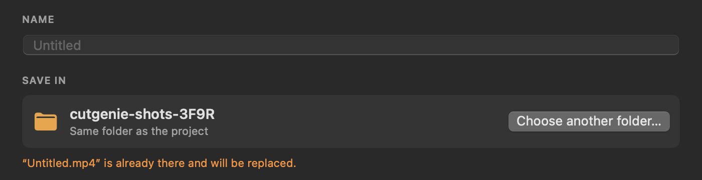

# If the file already exists

If a file with the same name is already in the folder, the Export window warns you in orange:
*“…” is already there and will be replaced.*

To keep the old file, change the **Name** (for example add *v2*), or click **Choose another folder…**.

Cutgenie remembers the folder you exported to last time.

## Next

[The keyboard map →](../11-shortcuts/01-keyboard-map.mdx)
