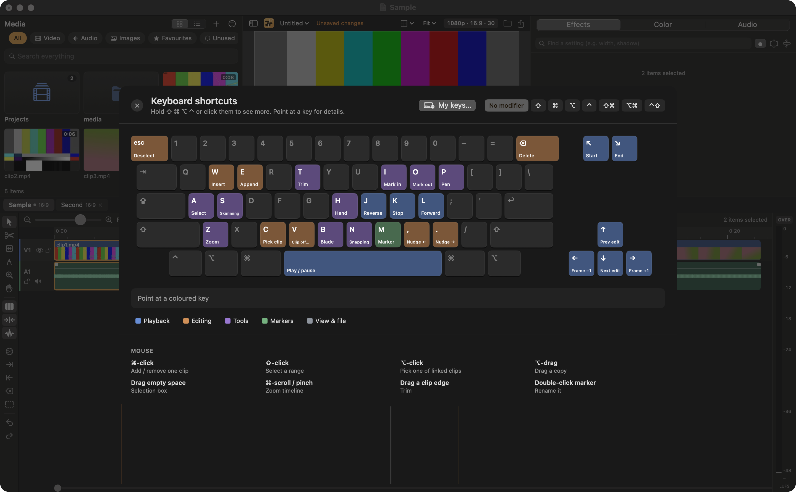

# The keyboard map

Press **⌘/** to open the keyboard map.

- Keys are coloured by kind: playback, editing, tools, markers, and view and file.
- Hold **⇧**, **⌘**, **⌥** or **⌃** (or click the buttons at the top) to see what keys do with that key held.
- Point at a key to see everything it does.
- Click a colour at the bottom to show only that kind.

Press **Esc** to close it.

## Next

[Change a shortcut →](02-my-keys.mdx)
