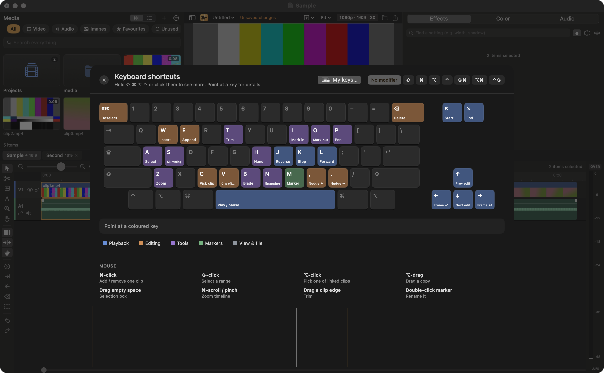

# All shortcuts

**Playback**

| Keys | Does |
| --- | --- |
| Space | Play / pause |
| J / K / L | Play backwards / stop / play forwards |
| ← / → | One frame back / forward |
| ⇧← / ⇧→ | Ten frames back / forward |
| ↑ / ↓ | Previous / next edit |
| Home / End | Start / end |

**Editing**

| Keys | Does |
| --- | --- |
| ⌘B | Blade (cut) at the playhead |
| ⇧B | Blade all tracks |
| ⌥[ / ⌥] | Trim start / end to the playhead |
| ⌫ | Delete (close the gap) |
| ⇧⌫ | Lift (leave a gap) |
| , / . | Nudge left / right (⇧ for ten) |
| ⌘C / ⌘X / ⌘V | Copy / cut / paste |
| ⌘A | Select all |
| W / E | Insert / append |
| C | Pick clip |
| V | Turn clip off / on |
| ⌃⇧S | Detach audio |
| ⌘L | Link / unlink |
| ⌘G / ⇧⌘G | Group / ungroup |
| ⌥⌘G | Sync by sound |
| ⌘Z / ⇧⌘Z | Undo / redo |
| Esc | Deselect |

**Tools**

| Keys | Does |
| --- | --- |
| A | Select |
| B | Blade |
| T | Trim |
| P | Pen |
| Z | Zoom |
| H | Hand |
| S | Skimming on / off |
| N | Snapping on / off |
| ⌥P | Magnetic on / off |
| I / O | Mark in / out |

**Markers**

| Keys | Does |
| --- | --- |
| M | Add marker |
| ⌥M | Add named marker |
| ⌃' / ⌃; | Next / previous marker |

**View and file**

| Keys | Does |
| --- | --- |
| ⌘= / ⌘− | Zoom timeline in / out |
| ⇧Z | Fit the whole timeline |
| ⌘1 | Show / hide media panel |
| ⇧⌘T | Big timeline |
| ⌥⇧⌘F | Big viewer |
| ⇧⌘F | Full screen |
| ⌃T | Add text |
| ⇧⌘G | Graph editor |
| ⌘S / ⇧⌘S | Save / save as |
| ⌘N / ⌘O | New / open project |
| ⇧⌘O | All projects |
| ⌘J | Project settings |
| ⌘E | Export |
| ⌘/ | Keyboard map |

**Mouse**

| Do | To |
| --- | --- |
| ⌘-click | Add or remove one clip from the selection |
| ⇧-click | Select a range |
| ⌥-click | Pick one of linked clips |
| ⌥-drag | Drag a copy |
| Drag empty space | Selection box |
| ⌘-scroll or pinch | Zoom the timeline |
| Drag a clip edge | Trim |
| Double-click a marker | Rename it |

## Next

[How editing with Claude works →](../12-editing-with-claude/01-how-it-works.mdx)
