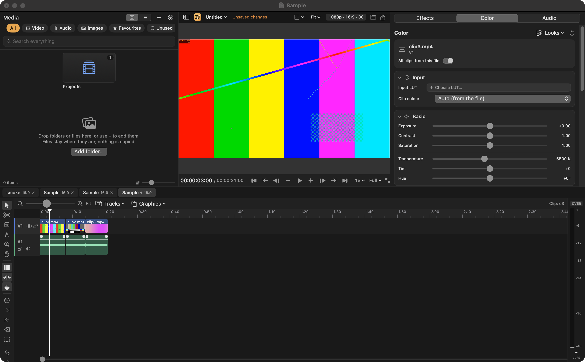

# How editing with Claude works

**Claude** is an AI assistant. With **Claude Code** (Anthropic's app for working on your computer) and the Cutgenie
**skills**, you can ask for an edit in plain words. No Claude Code? The regular Claude app for Mac works too, with the
Cutgenie extension (see [Use the Claude app instead of Claude Code](03-claude-desktop.mdx)). For example:

> *Cut the long pauses out of my intro, then add a lower third with my name at 0:05.*

Claude sends the edit to the open Cutgenie, and it appears on the timeline straight away. You watch it, change
what you don't like by hand, or ask Claude to change it.

**What is a skill?** A short set of instructions that teaches Claude one job, such as removing pauses or exporting
for YouTube. Cutgenie comes with 11 of them (see [The skills](05-skills.mdx)).

**How it connects.** While Cutgenie is open it listens for commands, but **only from your own Mac**. Nothing goes
over the internet to Cutgenie, and Claude can only do what the commands allow.

**Your recordings stay safe.** Claude never changes your original video or sound files. Every skill also saves a
version before it starts, so you can always go back. See [Safety: what Claude will and won't do](04-safety.mdx).

## Next

[Install the Cutgenie skills →](02-install.mdx)
