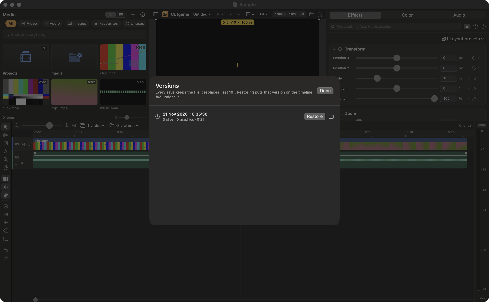

# Safety: what Claude will and won't do

Every Cutgenie skill follows the same five rules:

1. **It never touches your original media.** Your camera files, music and pictures are never moved, renamed,
   changed or deleted. Edits live only in the project.
2. **It saves a version first.** Before the first change, Claude saves the project. Cutgenie keeps your last 10
   versions, so you can go back with **Versions…** (see [Versions](../03-projects/06-versions.mdx)).
3. **It undoes its own mistakes.** If an edit comes out wrong, Claude undoes it before trying again, instead of
   piling more edits on top.
4. **It asks before overwriting an export.** If a file with the same name exists, Claude asks you first. Cutgenie
   itself also refuses to replace a file unless told to.
5. **It tells you what it did**, in plain words, and how to undo it.

You can always undo anything yourself with **⌘Z**, or go back to an earlier version.

**Check before you publish.** Claude can be wrong about what it sees and hears. Always watch the finished edit,
especially blurred areas and cuts, before you upload.

## Next

[The skills →](04-skills.mdx)
