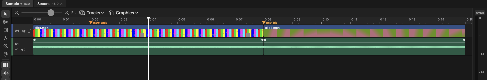

# Example: remove pauses

1. Open your project in Cutgenie.
2. Ask Claude: *Cut the pauses longer than half a second out of my video.*

Claude:

- saves a version,
- finds the quiet parts in your recordings (with ffmpeg),
- removes them from the end of the timeline backwards, leaving a short breath on each side,
- tells you how many it removed and how much shorter the video is.

3. Press **Space** to watch. If a cut feels too tight, press **⌘Z** to put it back, or ask Claude:
   *Put back the cut at 2:14.*

**Tip:** say how long a pause must be before it's cut. *Longer than 1 second* keeps a more relaxed pace.

## Next

[Example: titles and zooms →](07-titles-and-zooms.mdx)
