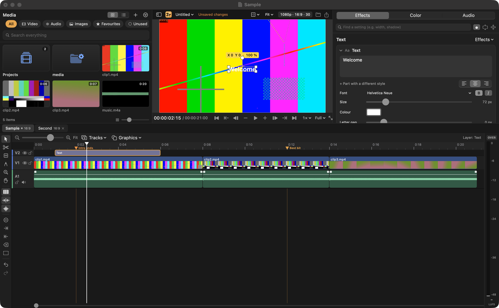
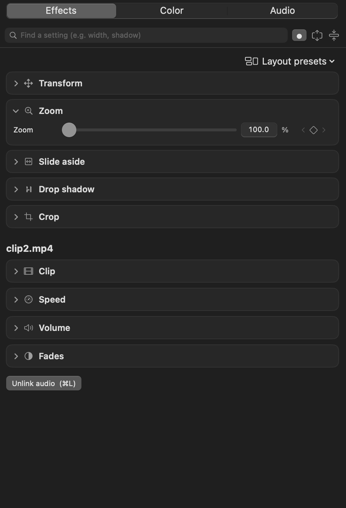

# Example: titles and zooms

**A lower third:**

> *Add a lower third at 0:05 with my name, Sam, and "Tech reviewer" under it.*

Claude adds a box and two lines of text, fading in and out, then checks a frame to make sure it looks right.

To change the colour or font, select it and use the inspector (see [Style text](../08-graphics/02-style-text.mdx)), or
ask Claude: *Make the box dark blue.*

**A slow zoom:**

> *Slowly zoom in on clip 2.*

Claude adds two zoom keyframes, so the picture pushes in gently over the clip. You can see them in the **Zoom**
section of the Effects tab.

## Next

[Example: sound and export →](07-sound-and-export.mdx)
