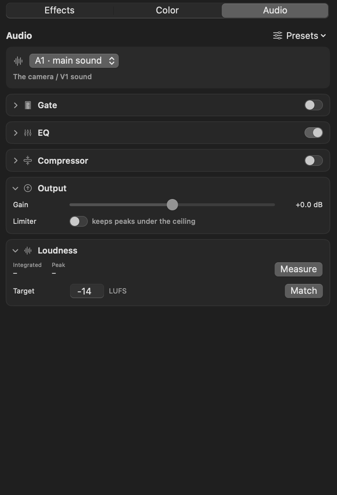

# Example: sound and export

**Loudness:**

> *Make my video as loud as other YouTube videos.*

Claude measures the loudness, sets it to **−14 LUFS** (the level YouTube uses), turns on the limiter so it never
distorts, and measures again to show you the before and after.

**Export:**

> *Export it for YouTube to my Movies folder.*

Claude exports with the YouTube settings (HEVC, high quality) and tells you the file's name and size. If a file
with that name is already there, it asks before replacing it.

**Check first:**

> *Is it ready to export?*

Claude looks for gaps, leftover tiny clips, missing files and loudness problems, and lists anything it finds with
the time, so you can decide what to fix.

## Next

[Tips for asking →](09-tips.mdx)
